# Lesson screen v7 prototype

A clickable prototype of the lesson screen for a complete beginner. It covers lessons 1 to 3 of TypeScript from zero. The goal is that a new player knows what to do within five seconds, does it, watches the scene react and sees progress.

The prototype is a design proposal. The game screens are unchanged, and nothing here is wired into the course.

## Open it

```sh
pnpm dev
```

Open `/prototype/lesson` on the dev server, or on any deployed build. Add `?lesson=sign-spaces` or `?lesson=call-order` to start at lesson 2 or 3. The status bar at the bottom also jumps between the three lessons.

The prototype runs the shipped pack worker, so the code you type is really executed and the shipped checks decide success. It never reads or writes saved progress. A reload starts lesson 1 again.

## States

The desktop frames are 1280x800. All of them live in [`shots/`](shots). Click one to see it at full size.

| | Idle | Typing, Run invited | Success | Failure |
| --- | --- | --- | --- | --- |
| **Lesson 1** | 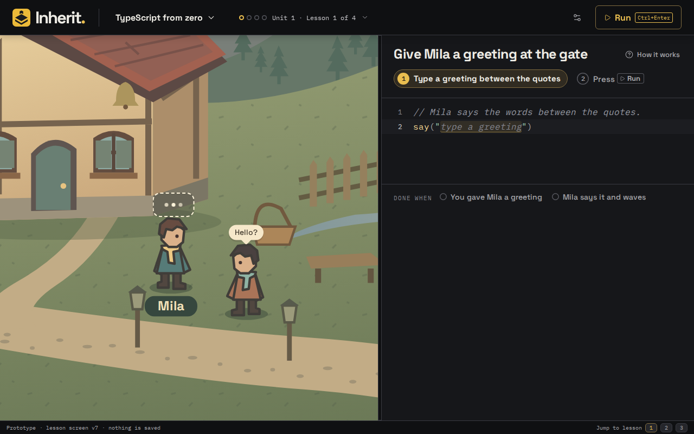 | 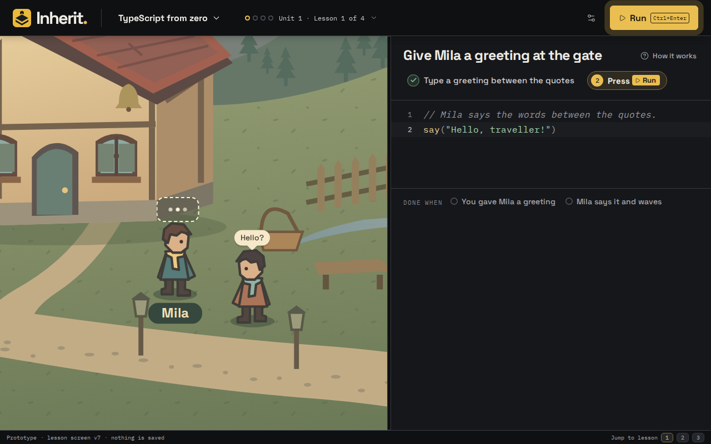 | 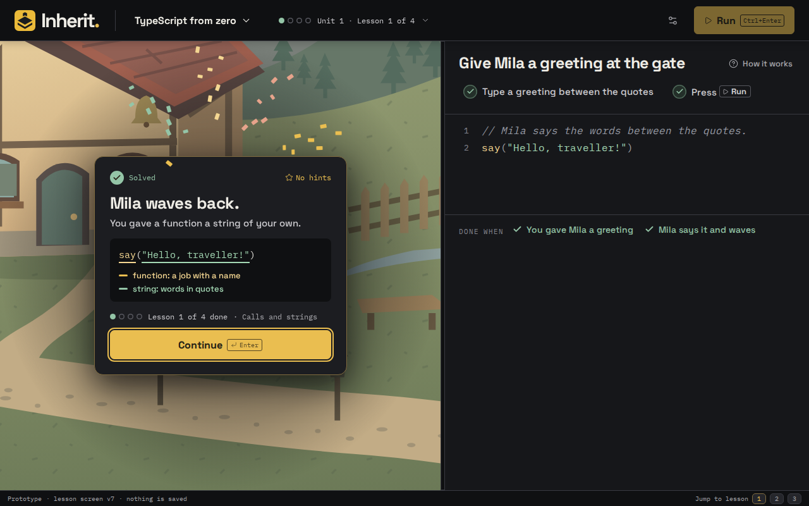 | 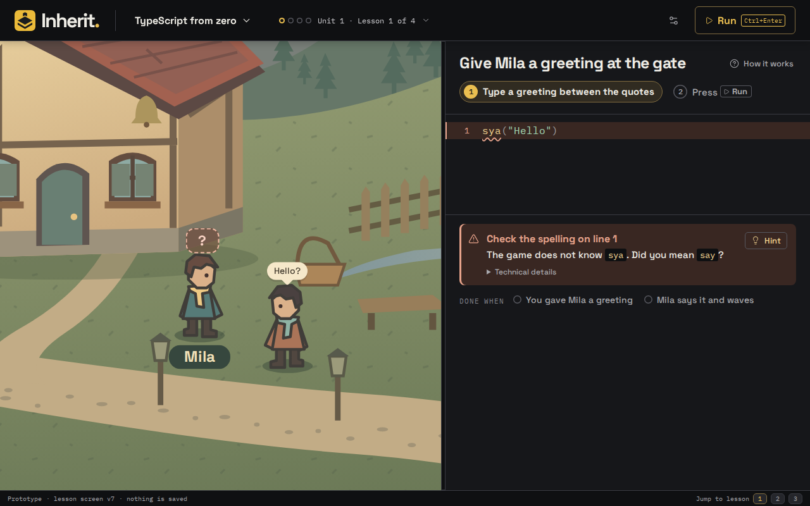 |
| **Lesson 2** | 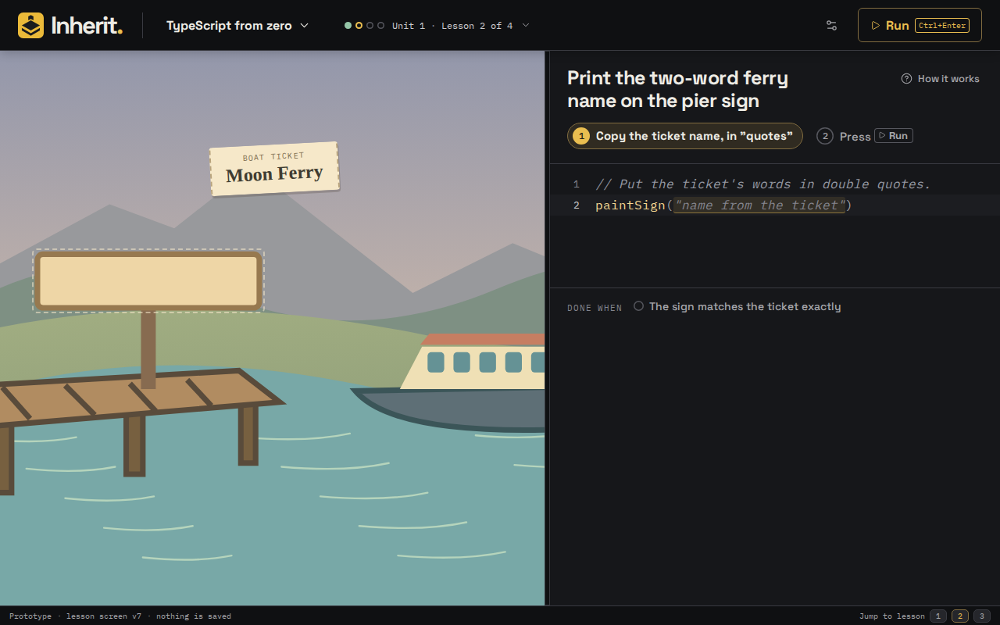 | 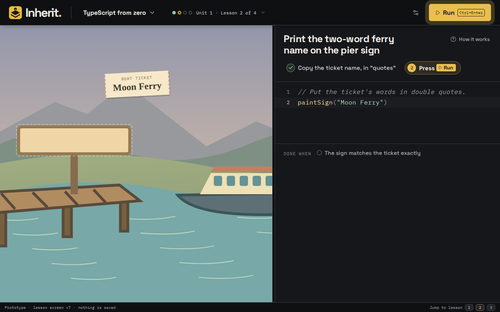 | 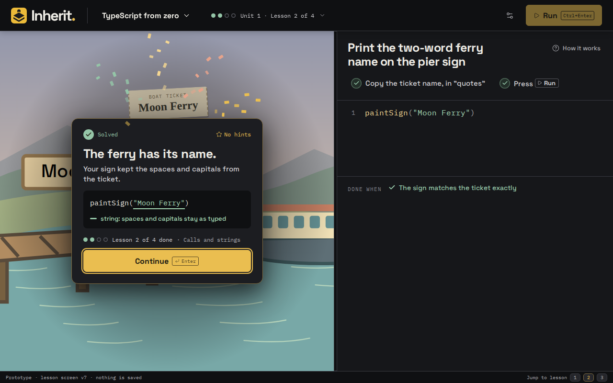 | 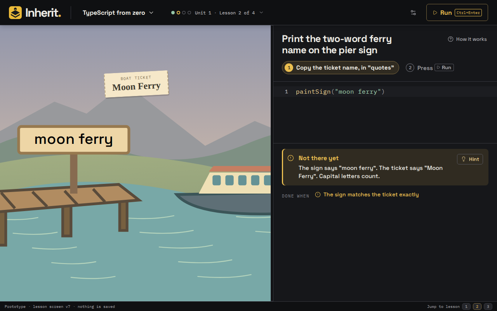 |
| **Lesson 3** | 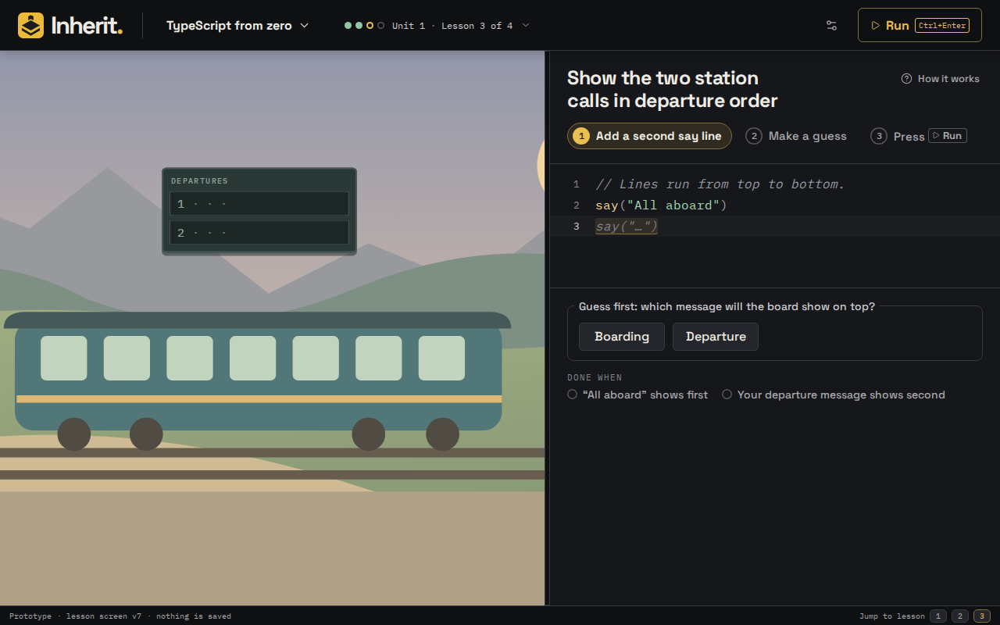 | 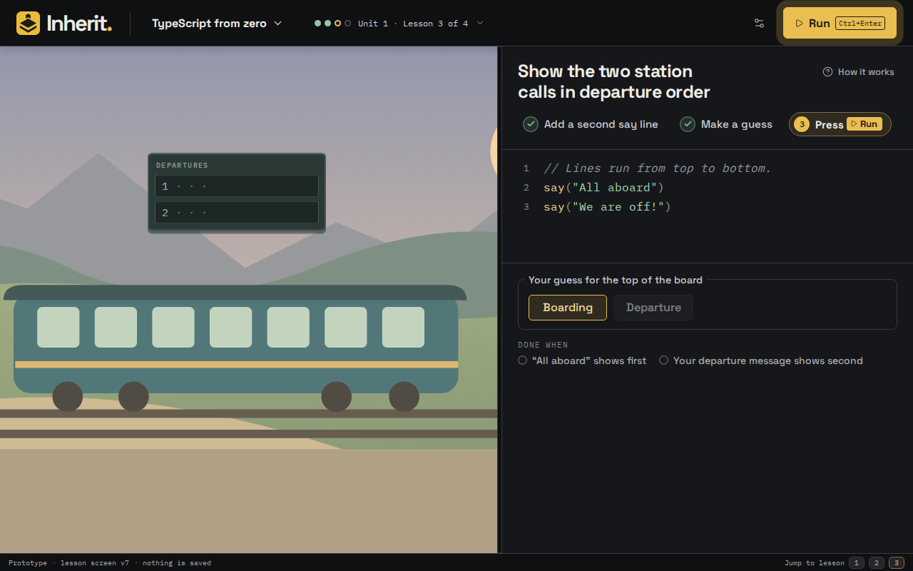 | 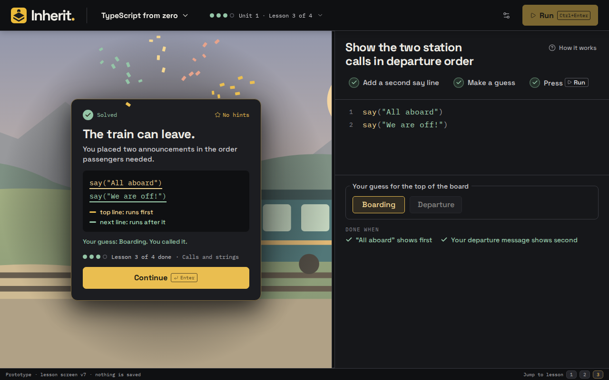 | 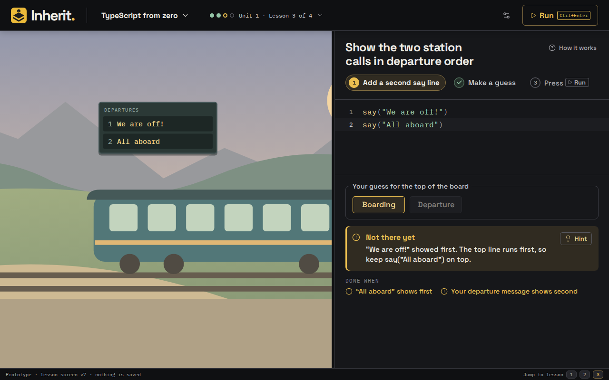 |

The failures differ on purpose. Lesson 1 is a typo that stops the code. Lessons 2 and 3 are code that runs but gives the wrong result.

| Scene reacts before the card | Course map popover | Help panel |
| --- | --- | --- |
| 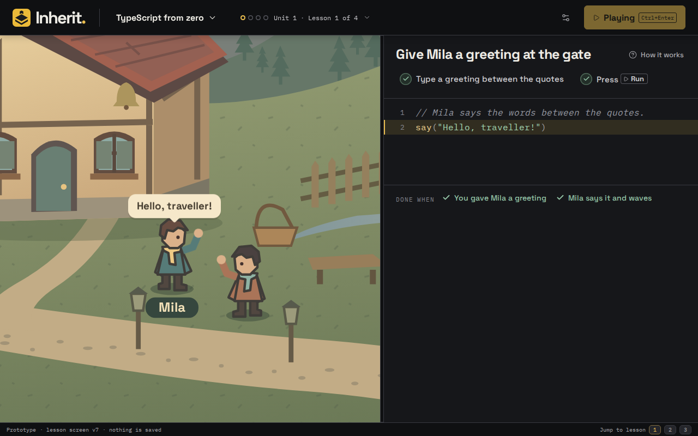 | 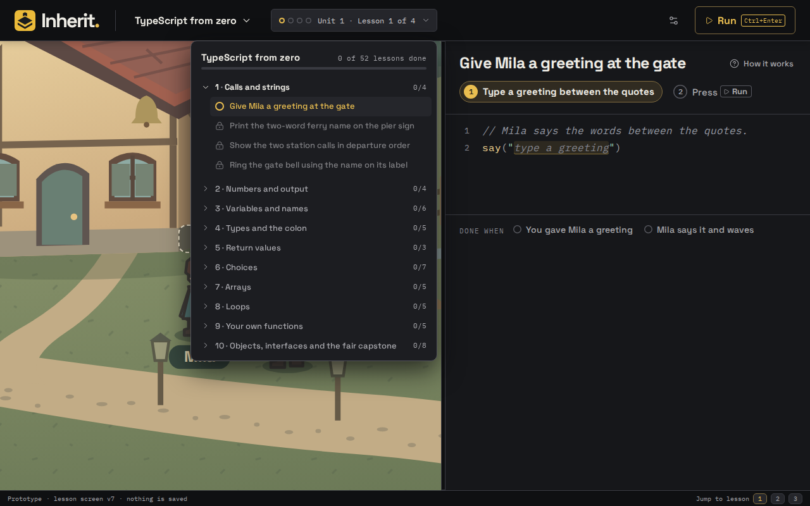 | 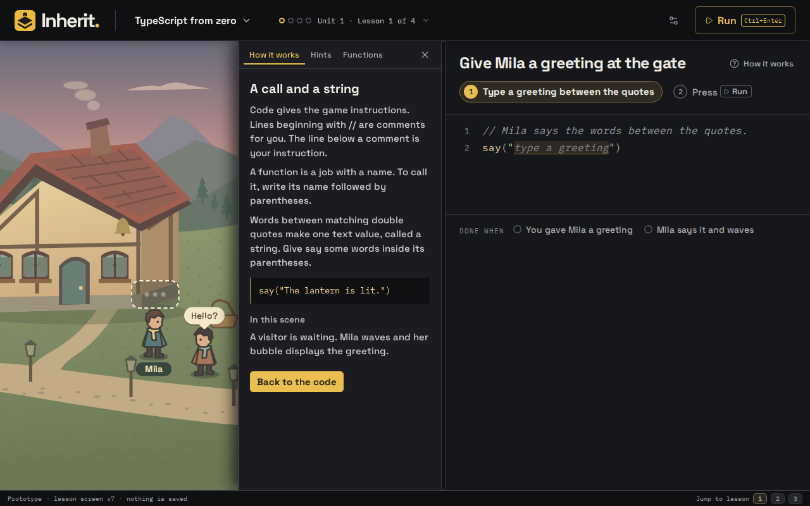 |

The narrow layout at 390x780:

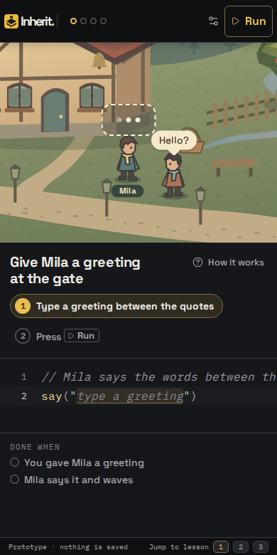 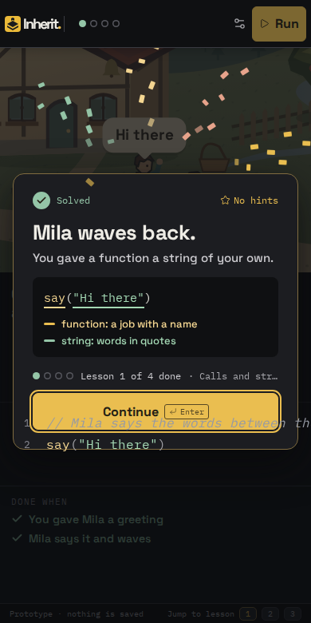

To regenerate the frames after a change:

```sh
pnpm build
INHERIT_SHOTS=/tmp/inherit-v7 pnpm exec playwright test tests/e2e/prototype-lesson.spec.ts
cp /tmp/inherit-v7/prototype/lesson-v7/*.png docs/prototypes/lesson-v7/shots/
```

## The problem

On the shipped lesson 1, a beginner sees three columns of text at once: the scene title, the open Learn drawer with the whole course map, and the task with its checks. The drawer covers half the scene. Mila is small. The editor holds one TODO comment. Nothing on the screen says "type here, then press Run".

## One rule

Gold marks the next step and nothing else. At any moment exactly one step chip is gold. Run turns solid gold only when the code is ready to run. Everything else on the screen is quieter than that.

## Reading order

1. **The goal**, one line at the top of the editor column: "Give Mila a greeting at the gate". It is the only heading on the screen.
2. **The step chips** under it: "1 Type a greeting between the quotes", "2 Press Run". The current step is gold and the finished ones show a tick.
3. **The editor**, with the caret already blinking where the words go.
4. **The scene**, where an empty dashed bubble over Mila shows where the result will appear.
5. **Done when**, one quiet line under the editor.

The scene has no title band and no caption. The lesson's cue is drawn in the scene: a visitor saying "Hello?" in lesson 1, a boat ticket reading "Moon Ferry" in lesson 2, an empty departures board in lesson 3.

## Visible by default, and what waits for a click

| Always visible | Opens on request |
| --- | --- |
| Top nav with pack name, progress chip, settings and Run | Course map, from the progress chip |
| Scene, cropped to the actors | How it works, from the button beside the goal |
| Goal and step chips | Hints, from the same panel or from a failure message |
| Editor with prefill | Functions reference, a tab in the same panel |
| Done when checks | Technical details of an error |

Nothing opens by itself. The help panel has three tabs: How it works, Hints and Functions. The course map is no longer inside it. When the panel opens, the camera slides so the actors stay in view beside it, and "Back to the code" closes it.

## Progress and the course map

The nav shows four dots for the current unit and "Unit 1 · Lesson 1 of 4". A finished lesson fills its dot. The same dots appear on the solved card, where the new one pops in.

Clicking the chip opens the course map as a popover over the scene. It lists the ten units with the current one expanded. It leaves the goal, the editor and the checks uncovered, and Escape or a click outside closes it.

## Editor prefill

Each lesson prefills everything the player has already met and leaves one new thing to type. A grey placeholder marks the spot and disappears when typing starts.

| Lesson | Prefill | The player types |
| --- | --- | --- |
| 1 | `say("")` with the caret between the quotes | Only the words |
| 2 | `paintSign()` with the caret between the brackets | The quotes and the words |
| 3 | `say("All aboard")` and an empty line below | A whole second call |

The support fades over three lessons, so nobody starts from a blank editor and nobody is handed the answer. One comment line above the code says what the line does in plain words. The editor pairs brackets and quotes, and code is set at 16 px.

## How Run is invited

Run stays in the top right at its shipped width. While the code is not ready it is outlined and calm. Once the code has what the step asked for, three things happen together: the typing step gets its tick, the "Press Run" chip turns gold, and Run fills with gold and pulses three times. Ctrl+Enter also runs.

While the code plays, Run reads "Playing" and the line being executed is highlighted in the editor. The scene reacts first. The solved card arrives about a second later, so the player sees their own words in Mila's bubble before anything covers it.

In lesson 3 the player also guesses the outcome first. The guess is a small card under the editor and counts as its own step. Pressing Run without a guess nudges that card.

## How checks read

The checks sit in one line under the editor, labelled "Done when". They describe the outcome in the scene.

| Shipped wording | Prototype wording |
| --- | --- |
| The player calls say with nonblank words | You gave Mila a greeting |
| Mila displays those words and waves | Mila says it and waves |
| The sign matches the ticket | The sign matches the ticket exactly |
| Boarding appears first | "All aboard" shows first |
| Departure appears second | Your departure message shows second |

Before the first run a check is a grey ring. Red is kept for real errors. After a run a passed check is a mint tick. A check that is still open turns gold and one sentence above explains the difference, read from the scene. For `paintSign("moon ferry")` it says: The sign says "moon ferry". The ticket says "Moon Ferry". Capital letters count.

## When the code has a mistake

The compiler's message is translated to plain words. The exact token gets a wavy underline, its line is tinted, and the slot in the scene shows a question mark. The original message is kept under "Technical details", and a Hint button sits beside the message.

| The player typed | Title | Body |
| --- | --- | --- |
| `sya("Hello")` | Check the spelling on line 2 | The game does not know `sya`. Did you mean `say`? |
| `Say("Hello")` | Capital letters matter in names | Write `say`, not `Say` on line 2. |
| `say(Hello)` | The words need quotes | Put double quotes around your words on line 2: `say("Hello")`. |
| `say("Hello)` | A quote is missing | Words start and end with a double quote. Add `"` after your words on line 2. |
| `say("Hello"` | A bracket is missing | Every opening bracket needs its partner. Add `)` at the end of line 2. |
| `say("")` | No words yet | Mila needs some words. Type them between the quotes on line 2, like `say("…")`. |
| `say(“Hello”)` | Those are curly quotes | Code needs straight double quotes: `"`. Retype the quotes on line 2. |

Anything else falls back to "Line 2 is not quite code yet" with the working example from How it works. `lesson-v7.test.ts` runs each of these lines through the real runner.

## Solved card

The card is centred over the game area. It carries the confetti, the shipped reaction and the shipped one-line summary. Below that it shows the player's own line with its two parts underlined and named: "function: a job with a name" and "string: words in quotes". The terms arrive after the success, attached to something the player just wrote.

There is exactly one button, Continue, and Enter presses it. The card has no other links.

## Narrow layout

Below 800 px the scene sits on top at about a third of the height, with the goal, steps, editor and checks stacked under it. Run stays in the nav. The progress chip keeps its dots and drops its label. The help panel becomes a bottom sheet and the solved card covers the screen centre.

## What the prototype fakes

- **The editor** is a light text area with highlighting. The game uses Monaco. Monaco can show the placeholder with injected text or a decoration.
- **The copy** for steps, check labels, prefill and "not there yet" sentences lives in `apps/web/app/prototype/lesson-v7/content.ts`, for three lessons. In production these would be lesson fields in `packages/sim`.
- **The speech bubble and board** are drawn over the shipped scene art. The shipped bubble cuts text at 15 characters, so the prototype hides it and draws a wrapping one.
- **The visitor** in lesson 1 is drawn over the scene with the shipped villager art.
- **One theory sentence** in lesson 1 mentions the old TODO comment. The prototype rewords that sentence on screen.

## To ship this

1. Add per-lesson fields for the step label, the prefill with its caret position, the camera box and the reason for an open check. Fill them for all 52 lessons.
2. Rewrite the check labels as outcomes.
3. Move the placeholder, the token underline and the running-line highlight into the Monaco editor.
4. Let scene bubbles wrap text, and draw each lesson's cue and empty slot in its scene.
5. Move the course map from the drawer to the nav chip.
6. Extend the plain-words table to the errors the later units produce.

## Known limits

- The solved card covers Mila and the visitor. The scene cannot scroll far enough to show both. The one-second delay before the card and the player's line on the card are the mitigation.
- The prototype covers only write and predict lessons. Fix, deploy and challenge lessons are not designed here.
- No beginner has tested it yet. The five-second claim is a design target.
